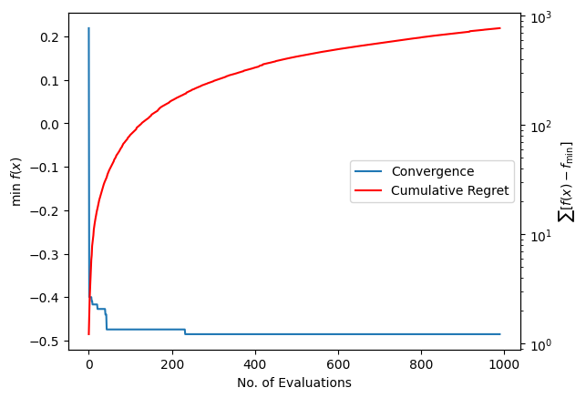
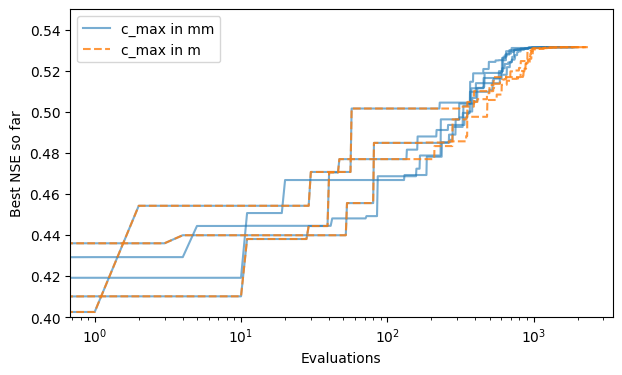

# Examples

Each card is a notebook from the repository's `docs/examples/` directory, rendered with
its saved outputs.

- [{ loading=lazy }](calibration.md "Calibration")
    **Calibration**

- [{ loading=lazy }](reliability.md "Reliable Calibration")
    **Reliable Calibration**

